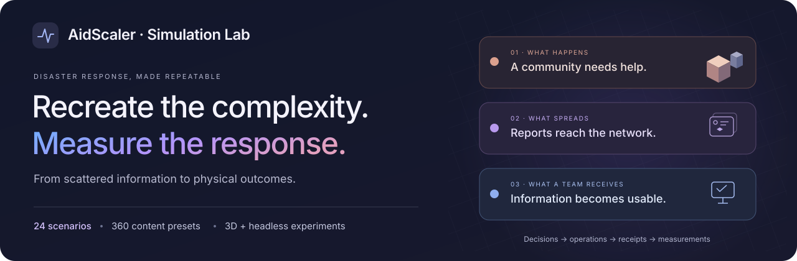
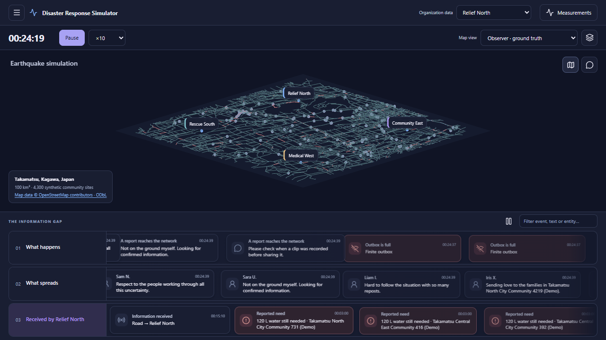

<p align="center">
  
</p>

<p align="center">
  <a href="https://aidscaler.com/demo/"><strong>Explore the live demo</strong></a> ·
  <a href="https://github.com/Hi-io/aidscaler-platform">AidScaler platform</a> ·
  <a href="docs/SCENARIOS.md">Scenarios</a> ·
  <a href="docs/EVALUATION.md">Impact evaluation</a> ·
  <a href="docs/API.md">API</a>
</p>

# Disaster Response Simulator

**A repeatable world for testing whether better decisions lead to help arriving sooner.**

This simulator recreates the operational complexity behind disaster response: changing needs, scattered public reports, overloaded teams, interrupted communications, limited supplies and vehicles moving through traffic. Actions change the simulated world, and their consequences are measured through physical receipts and service.

It is the independent evaluation environment for [**AidScaler**](https://github.com/Hi-io/aidscaler-platform), the disaster-response platform powered by Gemini on Google Cloud. AidScaler receives scoped information, investigates a response and submits authorized actions; the simulator determines what happens next.

**24 scenarios · 360 content presets · 26 input types · 25 action types · interactive 3D + headless evaluation**

## How it demonstrates AidScaler's impact

An earlier proposal matters when it becomes an earlier delivery. The simulator follows the full path: **a need appears → information travels → someone decides → a team acts → aid is received.**

The same initial conditions can be used for conventional and AI-assisted response. That connects improvements in information handling to measurable outcomes under the same resource and operational constraints.

| Outcome                         | Conventional response | AidScaler + Gemini |                  Improvement |
| :------------------------------ | --------------------: | -----------------: | ---------------------------: |
| Average wait for sufficient aid |             45.22 min |      **33.98 min** |      **24.85% less waiting** |
| Average time to authorization   |             28.60 min |      **18.92 min** |         **33.84% less time** |
| Human coordination effort       |        263 person-min |  **16 person-min** |         **93.92% less work** |
| Needs fully served              |               24 / 24 |        **24 / 24** | **Full coverage maintained** |

<sub>Recorded paired simulation · 18 October 2026 · Takamatsu, Japan · four organizations · Gemini 3.8 Flash on Vertex AI. Human effort is modeled; sufficient aid includes travel, unloading and receipt.</sub>

[Read the evaluation method →](docs/EVALUATION.md) · [Inspect AidScaler's recorded results →](https://github.com/Hi-io/aidscaler-platform/blob/main/docs/BENCHMARK.md)

## What the world simulates

| Layer                         | Interactions represented                                                                                                                                  |
| :---------------------------- | :-------------------------------------------------------------------------------------------------------------------------------------------------------- |
| **Disasters and access**      | Earthquakes, aftershocks, wildfire spread, rising floods and compound hazards; changing building conditions, road access and evacuation windows.          |
| **Communities and needs**     | Water, food, blankets, shelter and medical needs; recurring demand, vulnerable cohorts, shortages and exposure over time.                                 |
| **Geography and movement**    | Procedural regions and mapped Japanese road networks; junctions, curved routes, one-way roads, restrictions and background traffic queues.                |
| **Vehicles and cargo**        | Finite fleets, driver availability, fuel, cargo capacity, pickup, loading, travel, rerouting and unloading.                                               |
| **Supplies and ownership**    | Stock, protected reserves, expiring lots, reservations, transfers, purchases and partial receipts.                                                        |
| **People and facilities**     | Qualified staff, shifts, rest, assessments, power compatibility, setup and service dependencies; shelter admission and water production.                  |
| **Communications**            | Message transmission, bandwidth, latency, packet loss, coverage outages, disconnected drivers and reconnection backlogs.                                  |
| **Human attention**           | Finite reading, decision and relay queues; staffing, task durations, background workload and approval delays.                                             |
| **Public information**        | A scrapeable social network with posts, news, team reports, reposts, corrections, ambiguous claims and simulated image, video and voice-note attachments. |
| **Independent organizations** | Separate knowledge, depots, permissions and resources; owner approvals, shared commitments, withdrawals and coordinated responses.                        |
| **Public accountability**     | Funding, procurement, dispatch, receipt and publication as distinct, traceable stages.                                                                    |
| **AI and tool interaction**   | Scoped queries, verification, model timing and usage receipts, tool quotas, versioned actions and idempotent commands.                                    |

The [scenario catalogue](docs/SCENARIOS.md) connects these mechanics to specific capabilities: discovering an empty return trip, preparing a usable shelter, reaching a quiet community, coordinating complementary teams or adapting a response after conditions change.

## See the information gap

The viewer separates three perspectives so an evaluator can follow how information becomes action:

| Perspective              | What it shows                                                                |
| :----------------------- | :--------------------------------------------------------------------------- |
| **What happens**         | The underlying world: hazards, needs, traffic and physical operations.       |
| **What spreads**         | Reports as they are composed, transmitted, published, repeated or corrected. |
| **What a team receives** | That organization's received observations, messages and ingestion activity.  |

This lets you inspect the gap between an event, its public report and the team's knowledge. The observer sees the whole experiment; AidScaler works through the organization's source and action interfaces.

<details>
<summary><strong>View the 3D laboratory — Takamatsu, Japan</strong></summary>



A 10 × 10 km mapped region with 4,300 synthetic community and facility sites. Pan, zoom, follow vehicles and switch between observer and team perspectives. The viewer reflects the engine's state; camera movement does not advance the world.

Map data © OpenStreetMap contributors · [ODbL 1.0](https://opendatacommons.org/licenses/odbl/1-0/). [Geography and source attribution](docs/GEOGRAPHY.md).

</details>

## Built for repeatable experiments

- **Seeded worlds:** keep the same engine build, configuration and recorded inputs to replay the same event sequence.
- **Physical outcomes:** measure first useful aid, sufficient service, unmet demand, travel, fuel and resource utilization.
- **Controlled comparisons:** hold resources and scenario conditions constant while changing the response workflow.
- **Independent clock:** run interactive sessions or accelerated headless batches; the engine runs separately from browser rendering.
- **Inspectable history:** save manifests, checkpoints, inputs, event archives and metric exports.
- **Scalable observation:** compact map frames, scoped read models and a durable event transport keep visualization separate from authoritative state.

[Evaluation and replay →](docs/EVALUATION.md) · [Engine and runtime design →](docs/RUNTIME.md)

## Run the laboratory

Requires **Node.js 24+** and **pnpm 11**. The simulator runs without a model API key.

```sh
git clone https://github.com/Hi-io/disaster-response-simulator.git
cd disaster-response-simulator
pnpm install --frozen-lockfile
pnpm start
```

1. Open the [3D laboratory](http://127.0.0.1:4318/).
2. Use the generated observer key from the ignored `.local/session.json` file to enter the laboratory.
3. Choose a scenario, seed and map. Press **Play**, **Step** or **Advance world**.
4. Open the [fictional public feed](http://127.0.0.1:4319/feed) and compare it with a team's received information.

The world starts paused. Each organization has its own scoped access key. The [API guide](docs/API.md) explains how a response platform connects to those interfaces.

To run the same source and action APIs without the 3D viewer:

```sh
pnpm service -- --play
```

Use one server mode at a time; both use ports 4318 and 4319.

## Run and replay an experiment

```sh
node cli.mjs run --config manifests/unit.json --seed example-01 --output runs/example-01
node cli.mjs replay --checkpoint runs/example-01/checkpoint.json.gz
node cli.mjs batch --config manifests/unit.json --seeds example-01,example-02 --policies conventional,rules --workers 2 --output runs/comparison
node cli.mjs export --checkpoint runs/example-01/checkpoint.json.gz --output runs/export
```

The CLI's built-in policies are scripted reference controllers. The **AidScaler + Gemini** integration runs through the separate platform and the simulator API. [Full evaluation workflow →](docs/EVALUATION.md)

## Explore the repository

| Guide                                         | What you will find                                                       |
| :-------------------------------------------- | :----------------------------------------------------------------------- |
| [Scenarios](docs/SCENARIOS.md)                | All 24 situations and the response capabilities they exercise.           |
| [Impact evaluation](docs/EVALUATION.md)       | Paired comparisons, metrics, replay and the AidScaler benchmark.         |
| [API integration](docs/API.md)                | Public sources, organization-scoped queries, actions and receipts.       |
| [Runtime architecture](docs/RUNTIME.md)       | Engine isolation, event transport, compact views and hosted integration. |
| [Geography](docs/GEOGRAPHY.md)                | Procedural and mapped environments, provenance and attribution.          |
| [Models and measurement](docs/CALIBRATION.md) | Units, population assumptions, human-work parameters and interpretation. |

```sh
pnpm check
pnpm test
```

---

**Follow a decision all the way to its impact.** [Try the connected experience](https://aidscaler.com/demo/) · [Explore AidScaler](https://aidscaler.com/).
