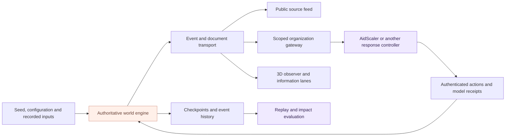

# Engine and runtime architecture

[Overview](../README.md) · [API](API.md) · [Evaluation](EVALUATION.md)

The simulator separates authoritative world execution from source delivery and visualization. Its backend clock drives physical events; viewers and connected platforms consume published state.

## Runtime layers



## Authoritative engine

Interactive launchers run the engine in a dedicated worker. Commands are ordered, and time advances in bounded batches while retaining the physical event sequence. HTTP readers, the durable queue and presentation consumers run outside that worker.

The engine records hazards, communications, human work, stock, ownership, transport, facilities and service. All successful actions enter this state and its history.

Library and deterministic headless runners can use the inline engine. Interactive clients use the isolated runtime and compact read views.

## Three information perspectives

The observer view distinguishes world events, circulating publications and the selected organization's received information. Each organization has its own source scope and knowledge.

The source timeline supports publication IDs, versions, search and pagination. Images, clips and voice notes are represented by synthetic media objects and descriptions. The public timeline and the 3D scene read the same world clock.

## Event and document transport

The durable event bus provides stable event IDs, ordered at-least-once delivery, leases, acknowledgements, retries and replay. Large immutable documents are referenced by SHA-256; consumers retrieve them by content revision.

The interfaces are explicit:

- `createLocalEventBus`: `publish / subscribe / pull / ack / nack / replay`.
- `createQueuedDocuments`: an injected document store with `put / get`.
- [Cloud bridge](../scripts/gcp-bridge.mjs): authenticated Pub/Sub transport for an external hosted application.

Consumers acknowledge after processing and handle repeated delivery by event ID. Presentation frames can be coalesced; authoritative history stays in the event archive.

## Compact views

The viewer loads a geographic bootstrap, then receives compact frames. Organization clients can request compact actor state and retrieve cached map/query results by revision.

| Observer endpoint       | Purpose                                                      |
| ----------------------- | ------------------------------------------------------------ |
| `/api/viewer/bootstrap` | Geographic baseline and initial presentation state.          |
| `/api/viewer/frame`     | Compact updates relative to that baseline.                   |
| `/api/activity`         | Recent information lanes.                                    |
| `/api/runtime`          | Engine tick timing, work duration, lag and transport status. |
| `/api/checkpoint`       | Complete authoritative checkpoint.                           |
| `/api/metrics`          | Exact evaluation at a captured simulation boundary.          |

These observer interfaces require observer authentication. Organization integrations use the separate scoped interfaces in the [API guide](API.md).

## Checkpoints and continuity

A checkpoint retains configuration, state, input boundaries and archive references. Replay verifies the recorded build and state hash. Recover the checkpoint with its referenced history and matching source identity.

For hosted interactive sessions, the engine worker writes its atomic checkpoint and returns a small archive receipt to the HTTP host. The public spectator renderer consumes an allowlisted projection; host controls remain separate.

The hosted director can generate further incidents and explicit supply replenishments for an interactive experience. Those interventions are recorded in the world. Finite benchmark runs use their own fixed-horizon configurations.

## Inspect runtime performance

These utilities create disposable experiments and write reports to ignored directories:

```sh
node scripts/runtime-benchmark.mjs
node scripts/organization-capacity.mjs --counts 0,1,2,3,4 --duration 20000
```

The first exercises multiple organization consumers, concurrent viewer/feed reads and delayed acknowledgements. The second measures memory, startup, CPU and request/tick behavior as visitor organizations are added.

Host throughput and rendering performance are reported separately from simulated response time. [Evaluation](EVALUATION.md) explains the impact measurements.

## Repository map

| Directory                       | Responsibility                                                                  |
| ------------------------------- | ------------------------------------------------------------------------------- |
| [`engine/`](../engine/)         | Physical state, communications, people, resources, operations and history.      |
| [`contracts/`](../contracts/)   | Configuration, inputs, actions, parameters and validation.                      |
| [`generators/`](../generators/) | Geography, hazards, information and scenario composition.                       |
| [`content/`](../content/)       | 360 content presets and social publication generation.                          |
| [`scenarios/`](../scenarios/)   | 24 named operational situations.                                                |
| [`sources/`](../sources/)       | HTTP gateway, scoped projections, workers and event transport.                  |
| [`viewer/`](../viewer/)         | Three.js scene, information lanes, controls and spectator rendering.            |
| [`evaluation/`](../evaluation/) | Metrics, batches, run artifacts, replay and comparisons.                        |
| [`tests/`](../tests/)           | Physical constraints, authority, information flow, transport and replay checks. |
